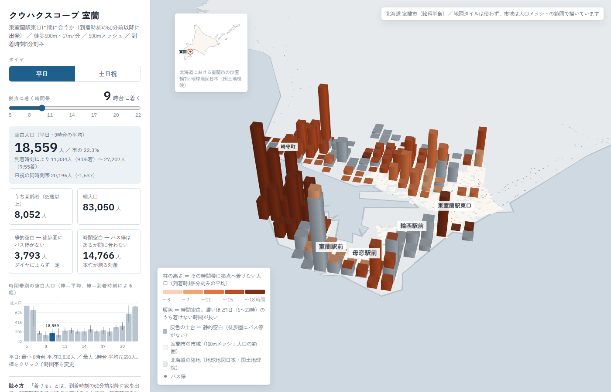

# クウハクスコープ

**バス停からの距離ではなく、時刻表で交通空白を測るツール。**
同じ地点でも時間帯・曜日で到達できるかが変わり、距離基準ではそれが見えません。
室蘭市の休日、7時台に拠点（東室蘭駅東口）へ着きたいとき、1時間前に家を出ても間に合わない人は
平均で市の27.9%（23,183人）です。同じ7時台でも7:00着なら46.1%、7:35着なら11.9%と、
数分の違いで大きく変わります。

**▶ アプリを開く: https://transit-accessibility-aik9qbme9ej2ue8wamnpvf.streamlit.app**
（しばらく使われていないと休止しており、最初の表示に1分ほどかかります）



## 3行でわかる特徴

| | |
|---|---|
| **診断** | 各メッシュから、到着時刻の60分前以降に家を出て生活拠点に間に合うかで空白を判定し、間に合わない人口を3Dマップで表示 |
| **処方** | 増便・ダイヤシフトが空白人口を何人減らすかを、費用（運行キロ）とあわせて比較 |
| **根拠** | 自作の時刻依存ダイクストラ法による決定的な計算。到着時刻を5分刻みにして時間帯の平均と幅を出す。テスト1,558件 |

## 概要
少子高齢化やバス運転者不足を背景に、全国で公共交通の路線廃止・減便が進んでいます。本ツールは、GTFSオープンデータと国勢調査メッシュ人口データを組み合わせ、路線廃止・バス停削除・減便が地域のアクセシビリティに与える影響を、地図上でシミュレーション・可視化します。核心は、時刻表由来で時間帯・曜日によって変わる到達可能性の欠落＝「時間空白」を、影響人口の3Dマップとして可視化することです。「代替路線の追加」による路線再編のシミュレーションも可能です。
対象エリア：デフォルト・北海道室蘭市（道南バス）

### 他地域での動作確認

GTFSを差し替えるだけで他地域にも適用できます。**網走バス**（北海道オープンデータ）で、
コードを1行も変更せずに動作することを確認済みです。

| | 室蘭（道南バス） | 旭川（旭川電気軌道） | 網走（網走バス） |
|---|---|---|---|
| 停留所 | 2,182 | 765 | 583 |
| 便数（平日） | 808 | 589 | 137 |
| 人口 | 83,050 | 329,601 | — |
| ネットワーク構築 | 4.1秒 | 1.0秒 | 0.3秒 |
| ダイヤ種別の自動判定 | 平日/土曜/日祝 | 平日/土曜/日祝 | 平日/土曜/日祝 |
| **空白人口の算出** | ✓ | **✓** | 人口データ未取得 |

旭川市での実算出（拠点＝共栄バスセンター、60分以内。旭川電気軌道GTFS 2026年11月11日からのダイヤ、
到着時刻を5分刻みにした時間帯の平均）:

| 到着の時間帯 | 平日 | 土日祝 |
|---|---|---|
| 7時台 | 222,119人（67.4%） | 238,439人（72.3%） |
| 9時台 | 177,702人（53.9%） | 200,153人（60.7%） |
| 17時台 | 210,261人（63.8%） | 216,748人（65.8%） |
| 20時台 | 189,146人（57.4%） | 200,161人（60.7%） |

同じ時間帯の中でも幅が大きく、平日7時台は7:00着なら328,141人、7:35着なら136,946人です。
平日9時台の内訳は 静的空白88,570人 ＋ 時間空白89,132人（空白人口のうち高齢者61,781人）。
11,911メッシュ×216通り（5〜22時台を5分刻み）の診断が0.7秒で終わります。

```bash
python tools/key_numbers.py --region <GTFSを展開したフォルダ> <人口CSV> 共栄バスセンター
```

```bash
python tools/verify_other_region.py <GTFSを展開したフォルダ>
```

空白人口の算出は、標準地域メッシュコードから座標を復元する実装のため地域に依存しません
（室蘭は1次メッシュ6340番台、網走は6443〜6645番台で、どちらも破綻しないことを確認）。

人口メッシュは**桁数から粒度を自動判別**します。国勢調査のメッシュ統計は全国で
500mと1kmが整備されているため、GTFSが公開されている地域なら人口データを用意できます。

| 桁数 | 粒度 | 例 |
|---|---|---|
| 8桁 | 約1km（3次メッシュ） | `63403779` |
| 9桁 | 約500m（4次メッシュ） | `634037791` |
| 10桁 | 100m | `6340377901`（室蘭で使用） |

なお**網走市のメッシュ人口データは未入手**のため、他地域での空白人口の実算出は未実施です。

アプリのサイドバーからGTFS（ZIP）をアップロードして差し替えることもできます。地図は出発地を中心に開き、
路線の線はアップロードしたGTFSの shapes.txt から描きます。人口データと時刻表の地域が重ならない場合は警告します。

## 機能一覧

分析は「① 空白を見つける → ② 廃止・減便シミュレーション → ③ 改善策の比較」の3段に分かれています。
全モードで平日・土曜・日祝のダイヤを切り替えられます。

### ① 空白を見つける

1. **時間空白診断（3D）** — 各メッシュから、到着時刻の制限時間（既定60分）前以降に家を出て生活拠点に間に合うかで空白を判定し（定義は「アルゴリズムの詳細」を参照）、間に合わない人口を500mメッシュの3Dカラム（pydeck）で表示します。到着時刻を5分刻みにして判定し、時間帯（例: 7時台＝7:00〜7:55着）の平均と、到着時刻による幅を表示します。徒歩圏にバス停がない「静的空白」と、バス停はあるが間に合わない「時間空白」を区別します。Streamlit 無しで開ける単体版を docs/ にも用意しています（本README後半を参照）。
2. **時間帯別到達圏** — 5〜22時台の出発時刻を5分刻み（216通り）で一括計算し、時間帯ごとに「何通りの出発時刻で行けるか」を地図に色分けします。5分刻みの折れ線で、同じ時間帯の中でも出発が数分違うだけで到達範囲が大きく変わることを確認できます。
3. **到達圏のみ** — 出発バス停・出発時刻・制限時間を指定すると、行けるバス停を所要時間で4段階に色分けして表示します。バス停をクリックすると乗り継ぎ経路が出ます。
4. **集客圏分析** — 施設に指定の時刻までに着くには、どこから来られるかを逆方向の探索で求め、その範囲の人口を数えます。
5. **施設アクセス** — 出発地から制限時間内に行ける医療機関・学校などを数えます。施設から徒歩500m以内の停留所のうち最も早く着ける停留所を使い、施設まで歩く時間も含めて制限時間と比べます。歩行速度は一般（分速67m）/高齢者（分速40m）から選べます。

### ② 廃止・減便シミュレーション

前後の到達圏を比べ、到達不能（赤）・悪化（オレンジ）・影響なし（グレー）を色分けし、影響を受ける人口（うち65歳以上）と施設アクセスの変化を示します。

6. **路線廃止**（複数路線同時対応） — 出発地から直接乗れる路線と乗り換えで使う路線に分けて選べます（高速バスは選択肢から外しています）。
7. **減便** — 3方式から選べます。いずれも便を方向・経路（停留所の並び）ごとに時刻順に並べて間引くので、片方向だけが全廃になることはありません。
   - 特定路線の便数を半分にする（1本おきに残す）
   - 特定路線の便を間引く（N本に1本残す。Nは2〜6）
   - 全路線一律で削減（10%-80%）。実際に減った便数と割合を表示します。削減率を上げると、削る便は前の率で削った便に追加されるだけなので、結果は必ず悪化側に動きます
8. **バス停削除** — 路線は残し、削除したバス停を通過扱いにします。徒歩圏距離は300m（都市部基準）/500m（地方部基準）から選べます（国交省ハンドブック基準）。

### ③ 改善策の比較

9. **改善策** — 空白地域を通る路線を候補にして、増便とダイヤシフトの効果を「空白人口の減少（5分刻み・全時間帯）」と「運行キロの増分」で比べます。足す便は、拠点を通る時刻が対象の時間帯に入るよう置きます。比較結果から自治体向けの**政策文書の下書き**（Markdown）を作れます。**数値はすべてアプリ側で決定的に算出しており、生成AIは使いません。** 任意で自分のAnthropic APIキーを入力すると文章の推敲にClaudeを使えますが、その場合も「下書きに無い数値が増えていないか」を機械的に照合して表示します（キーは保存しません）。
10. **代替路線追加** — 既存路線を廃止した上で、任意のバス停を結ぶ新規路線を追加します。運行間隔・平均速度を指定して、行き・帰りの両方向の仮想時刻表を生成します。

### データ

- 人口は簡易100mメッシュ人口（令和2年国勢調査の250mメッシュ人口を建物面積で按分した推計値）を使います。1メッシュの値は実人数そのものではないので、範囲で合計して使います
- サイドバーからGTFS（ZIP）、施設データ（CSV）、人口データ（CSV）を差し替えられます。読み込んだ時刻表の有効期間を画面に表示し、期限が切れていれば警告します

## 技術スタック

| 要素 | 技術 |
|---|---|
| 言語 | Python 3.12 |
| Webフレームワーク | Streamlit |
| 地図可視化 | Folium + streamlit-folium（2D）／ pydeck・deck.gl（3Dカラム） |
| グラフ探索 | 時刻依存ダイクストラ法（自作実装） |
| 数値処理 | pandas・numpy |
| データソース | GTFS-JP（道南バス）、簡易100mメッシュ人口、国土数値情報 |
| デプロイ | Streamlit Community Cloud |

## アルゴリズムの詳細

### 時刻依存ダイクストラ法
通常のダイクストラ法と異なり、エッジのコストが到着時刻によって変化します。8:15に東室蘭駅に着けば8:20発のバスに乗れる（待ち5分）が、8:25に着いたら次の9:00発まで待つ必要がある（待ち35分）。この時刻依存性により、出発時刻によって到達圏が大きく変化することを正確にシミュレーションできます。

### 空白の定義（時間空白診断・改善策）
到着時刻 T（例 7:00）について、T の制限時間（既定60分）前以降に家を出て、T までに拠点へ着ける経路があれば「着ける」とします。

・早く着いて拠点で待つ時間も制限時間に含みます。始発で6時に着いて9時まで待つ人を「9時に着ける」と数えると、時間空白が見えなくなるためです
・そのため T を遅らせても空白人口が減るとは限りません（室蘭の休日: 7:45着 17.5% → 8:00着 27.5%）
・時間帯の値（例: 7時台）は、T を7:00〜7:55の5分刻みで動かした12通りの平均です。同じ時間帯でも T によって大きく変わるため、幅も併記します
・家から乗車する停留所までは直線距離で歩くとみなします（既定500m以内・分速67m）。乗り換えの余裕時間は見込んでいません（時刻表上で間に合えば乗り継げる）

### ネットワーク構成
- バスエッジ: GTFSのstop_times.txtから同一便内の連続停車をエッジとして生成（出発時刻・到着時刻付き）。全ダイヤ分を持ち、平日／土曜／日祝の切り替えは実行時に便で絞る
- 徒歩エッジ: 300m以内のバス停間にHaversine距離ベースで生成（歩行速度67m/分）。徒歩の乗り換えを続けて2回はしない
- ダイヤ種別: calendar.txt の曜日で判定する（calendar_dates.txt の臨時ダイヤは使わない）

### バス停削除の通過扱い
削除バス停を含む便の前後バス停を直通エッジで接続。削除バス停と徒歩エッジで接続されていた近隣バス停同士を新たに徒歩エッジで直接接続。バスエッジのみの接続には新規徒歩エッジを追加しない（意図しない新規接続を防止）。

### 施策のモデル化
- 代替路線: 指定バス停を結ぶ新規バスエッジを、行き・帰りの両方向とも時刻表付きで生成
- 増便・ダイヤシフト: 停留所パターン（方向・経路）ごとに便を足す・移す。拠点を通る時刻が指定の時間帯に入るよう置く（拠点を通らない系統は始発時刻）
- 減便: 停留所パターンごとに時刻順に間引く。一律削減は、削減率を上げても前に削った便が戻らない順（van der Corput 列）で選び、実際の削減率を指定の±1ポイント程度に保つ

## 分析から得られた知見
（いずれも制限60分。出発・到着時刻を5分刻みにして、時間帯の平均と幅で示す。`python tools/key_numbers.py` で再計算できる）

> 2026年10月30日に、時刻の取り方を毎時00分の1点から5分刻みに改めました。00分の1点だけで測った以前の値は、
> 時刻の取り方に左右されていました。例えば「休日7時に46.1%」は7時台で最も悪い1分の値で、
> 「路線廃止で到達不能を生むのは5路線のみ」「東室蘭駅東口を削除しても影響は自身のみ」は8:00発だけに当てはまる結論でした。
> 減便の値は、間引き方の不具合（方向を区別せず間引くため片方向だけ全廃になる路線があった、
> 一律削減の実際の削減率が指定とずれていた）を直したうえで出し直しています。

- **時間帯格差**: 室蘭駅前から60分以内に行ける停留所は、5時台の出発で平均35箇所（出発時刻により10〜93）、10時台で平均238箇所（132〜329）。時間帯の平均で約7倍。00分ちょうどだけで比べると30倍になるが、5:00発は始発前で時間帯の代表にならない
- **時間帯の中の揺れ**: 東室蘭駅東口へ7時台に着きたいとき、1時間前に家を出ても間に合わない人口は、平日21.8%に対し休日27.9%。同じ休日7時台でも、7:00着なら46.1%、7:35着なら11.9%と、曜日の差より時間帯の中の揺れのほうが大きい
- **路線廃止の影響**: 100路線（高速・都市間を除く）のうち、室蘭駅前を8時台に出発する場合、どこかの出発時刻で到達不能を生むのは17路線。安定して影響が大きいのは絵鞆循環線（8時台の平均49停留所）。影響が出発時刻しだいの路線も多く、「12 みたら・東室蘭駅東口線」は8:00発なら72停留所が到達不能になるが、8:05発以降は0
- **減便の影響**: 全路線一律に減らすと、室蘭駅前を8時台に出発する場合の到達不能は、30%で平均28停留所（出発時刻により0〜109）、40%で平均38（19〜109）、50%で平均91（47〜241）。40%から50%で大きく増える
- **主要停留所の削除**: 東室蘭駅東口を削除すると、室蘭駅前を8時台に出発する場合、8:35〜8:45発では85停留所が到達不能になる（8時台の平均21）。8:00発だけで見ると影響が無いように見える
- **処方の候補**: 便数の多い路線を選んでも空白は減らない。最多便の「03 鉄北北口線」（休日43便）は129停留所を通るが、休日7時台に空白になる地域の停留所は1つも通らない

## 使用データと出典

| データ | 出典 | ライセンス |
|---|---|---|
| バス時刻表（GTFS-JP） | 道南バス株式会社（2026年10月1日改正ダイヤ、有効期間 2026年10月1日〜12月25日）。[北海道オープンデータ](https://ckan.hoda.jp/dataset/gtfs-data)から取得 | [ODPT基本ライセンス](https://developer.odpt.org/terms/data_basic_license.html) |
| 100mメッシュ人口 | [簡易100mメッシュ人口](https://gtfs-gis.jp/teikyo/)（令和2年国勢調査の250mメッシュ人口を、建物面積で100mメッシュに按分した推計値。作成: 西澤明（東京大学空間情報科学研究センター）） | CC BY |
| 北海道の海岸線 | [地球地図日本](https://www.gsi.go.jp/kankyochiri/gm_jpn.html)（国土地理院） | 国土地理院コンテンツ利用規約 |
| 徒歩圏距離の基準 | 国土交通省「都市構造の評価に関するハンドブック」（2014年） | ― |
| 施設POI（医療142件・学校） | [国土数値情報 医療機関（P04）](https://nlftp.mlit.go.jp/ksj/gml/datalist/KsjTmplt-P04-v3_0.html)・[学校（P29）](https://nlftp.mlit.go.jp/ksj/gml/datalist/KsjTmplt-P29-v2_1.html)（国土交通省） | 国土数値情報利用約款 |

> 施設データは `python tools/build_facilities.py` で再生成できます。学校の分類コードは
> 公開メタデータに定義が無いため、北海道全2,824件の名称から実証して対応付けています
> （`tools/verify_school_codes.py`）。福祉施設（P14）は室蘭市のデータが存在しないため未収録です。
> アプリのサイドバーから任意の施設CSVを読み込むこともできます。

## プロジェクト構成

```text
transit-accessibility/
├── app.py                    # Streamlitアプリ本体（10モード）
├── transit_engine.py         # 計算エンジン（時刻依存ダイクストラ法）
├── blank_area.py             # 時間空白の診断（空白人口の算出、5分刻みの1日分の診断）
├── prescription.py           # 処方（増便・ダイヤシフトの効果比較）
├── policy_report.py          # 政策文書の生成（数値は決定的・AI整形は任意）
├── session_data.py           # 訪問者ごとのアップロード処理（共有ファイルに書かない）
├── service_calendar.py       # ダイヤ種別（平日/土曜/日祝）の判定
├── population.py             # 人口データ・施設データ管理
├── build_network.py          # GTFSからネットワーク構築
├── bus_edges.csv             # 全ダイヤ分のバスエッジ（113,730行）
├── walk_edges.csv            # 停留所間300m以内の徒歩エッジ
├── facilities.csv
├── 100m_mesh_pop2020_01205室蘭市.csv
├── test_all.py / _v2 / _v3   # 自動テスト（467 / 137 / 732件）
├── test_blank_area.py        # 自動テスト（56件）
├── test_day_type.py          # 自動テスト（19件）
├── test_scenario.py          # 自動テスト（33件）
├── test_prescription.py      # 自動テスト（31件）
├── test_policy_report.py     # 自動テスト（58件）
├── test_session_isolation.py # 自動テスト（25件）
├── docs/                     # 3Dマップ・技術仕様書・分析のしくみ・進捗報告
├── tools/                    # 3Dマップの生成・README の数字の再計算（key_numbers.py）
├── gtfs_data/
└── requirements.txt
```

## テストで検証している主な不変条件（合計1,558件）

件数の一部は路線・施設ごとに生成されるため、データを差し替えると変わります。

・時間帯の値：5分刻みの判定を平均したもので、メッシュ別の値を足すと一致し、到着時刻による最小と最大の間に入る。1時刻ずつの診断とも行ごとに一致する
・単調性：便を増やせば到達範囲は広がる（土曜+平日 ⊇ 各々）。減便率を上げれば空白は増える（削る便が入れ子になる）
・減便の間引き方：半減・N本に1本は方向・経路ごとに時刻順で行う。一律削減の実際の率は指定の±2ポイント以内
・代替路線：帰りの所要時間が行きと同じで、どの便も時刻をさかのぼらない
・施設アクセス：高齢者の速度では所要時間が長くなり、行ける施設が増えない。行ける施設は歩く時間を含めて制限時間以内
・一致性：改変後エッジを返す関数と、従来のシミュレーション関数の結果が一致する
・保存則：500mメッシュへの集約で総人口・空白人口が保存される
・費用中立：ダイヤシフトで総便数・総運行キロが変わらない
・訪問者の分離：公開環境で1人がダイヤ切替・処方計算・GTFSアップロードをしても、他の訪問者の結果は変わらない（共有エンジンのままだと、処方計算中の別訪問者に平日9時の空白人口が19,867人ではなく77,690人と表示されていた）
・文書の再現性：政策文書はAPIキー無しで必ず生成され、記載の数値は画面の計算結果と一致する。AIで推敲した場合も、下書きに無い数値が混入すれば検出される。出典は実際に使ったデータから作る
・データ整合性（エッジの移動時間が非負、自己ループなし）、到達圏の時間制約

## セットアップ

```bash
git clone https://github.com/K-hskw/transit-accessibility.git
cd transit-accessibility
python -m venv venv
.\venv\Scripts\Activate.ps1      # Windows PowerShell
pip install -r requirements.txt
streamlit run app.py
```

bus_edges.csv と walk_edges.csv はリポジトリに含まれているため、
`python build_network.py` の実行は不要です（GTFSを差し替えたときのみ）。

## ドキュメント
・[技術仕様書（2026-10-30）](docs/クウハクスコープ_技術仕様書_20261030.pdf) — 設計判断、アルゴリズム、修正した不具合、既知の限界をまとめたもの
・[分析のしくみ（2026-10-30）](docs/クウハクスコープ_分析のしくみ_20261030.pdf) — 10種類の分析がそれぞれ何をどう計算しているか（専門外の読み手向け）
・[進捗報告（2026-09-21）](docs/クウハクスコープ_進捗報告_20260921.pdf) — その時点で修正した計算バグと、更新した分析結果の対照表（数値は毎時00分の1点で測った当時のもの）
・以前の版の技術仕様書（09-28版）も docs/ に残しています。数値の取り違えがあるため、引用は最新版から行ってください

## 時間空白の3Dマップ（docs/）
「時間空白診断（3D）」モードと同じ計算結果を、Streamlit 無しで開ける1枚の
HTMLとして docs/kuhaku-scope-muroran.html に置いています。各メッシュから
生活拠点（既定：東室蘭駅東口）に間に合わない人口（到着時刻の60分前以降に家を出る場合）を、500mメッシュの
3Dカラムで表示し、到着の時間帯とダイヤ（平日／土日祝）を切り替えられます。
値は到着時刻を5分刻みにした時間帯の平均で、到着時刻による幅も表示します。
灰色の土台が静的空白（徒歩圏にバス停がない）、暖色の柱が時間空白（バス停は
あるが時刻表の都合で間に合わない）です。

### 再生成
```bash
python tools/build_map3d.py
```
外部依存は deck.gl（jsdelivr）と Google Fonts のみで、生成後はブラウザで
直接開けます（地図タイルは使いません）。

---

開発者：K-hskw 
